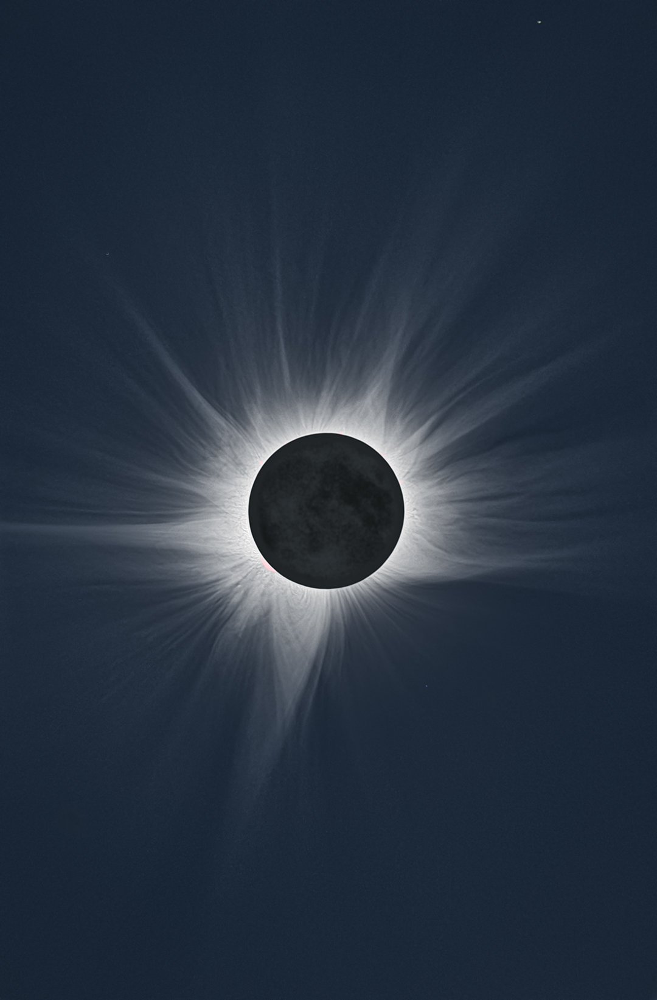
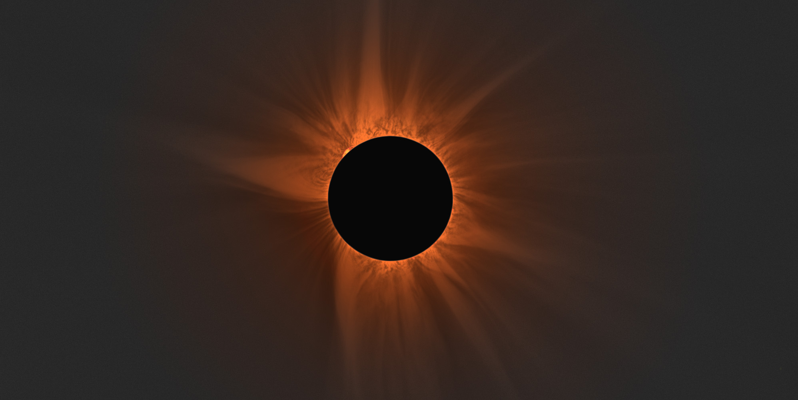
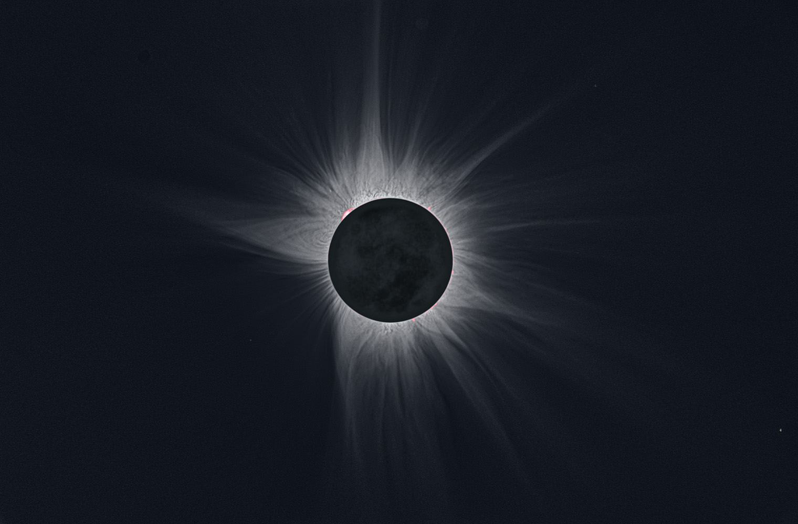
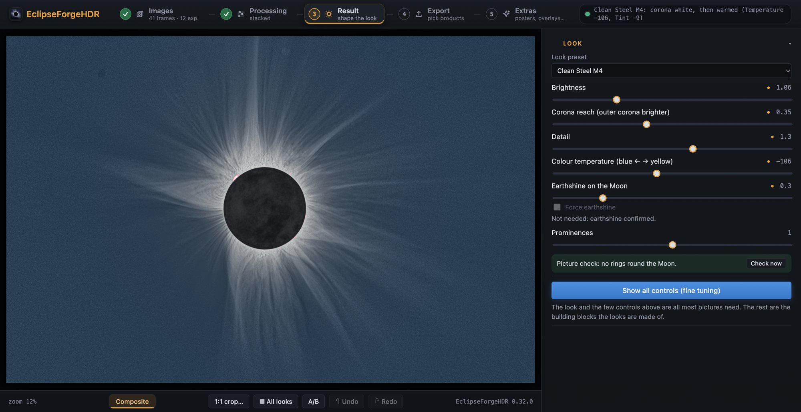
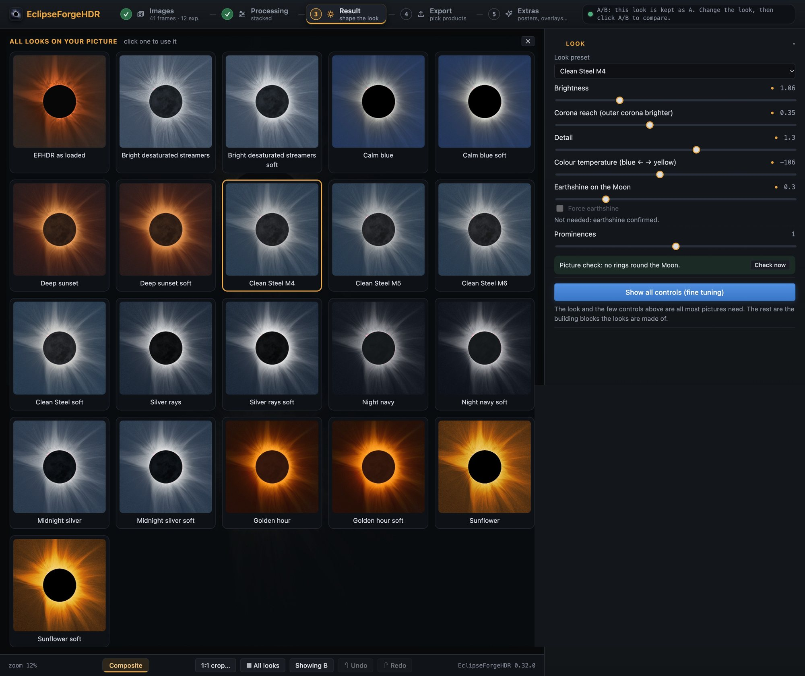
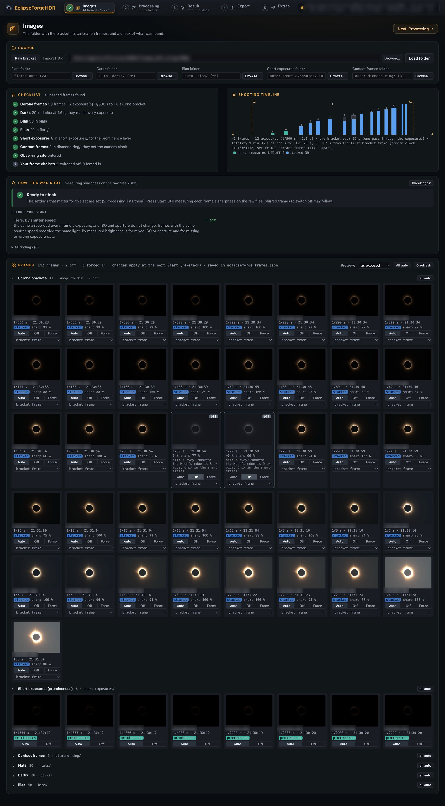
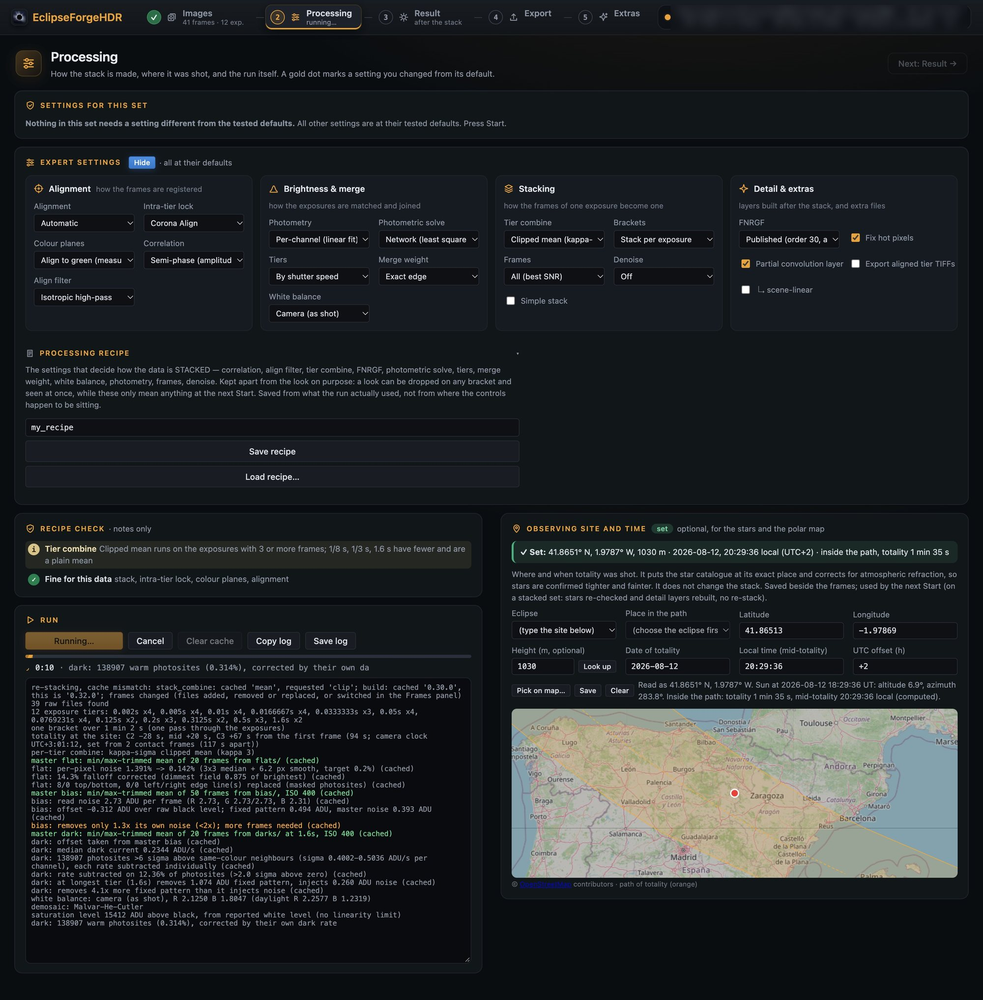
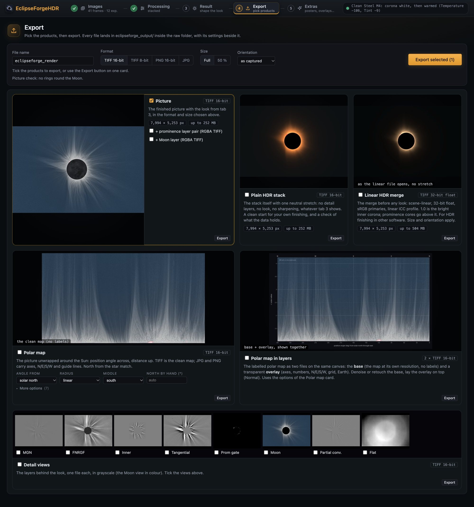
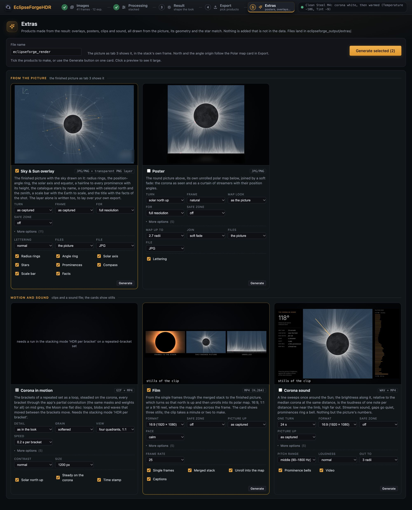

# EclipseForgeHDR

**High-Dynamic-Range Solar Eclipse Image Processing** — version 0.32.0

*Example result, stacked and rendered in EFHDR v0.28.0, including
the Moon and prominence layers; noise reduction (NoiseXTerminator) afterwards
in Photoshop.*

**Your bracketed totality frames in, a finished corona picture out:** the inner
and the outer corona in one image, the Moon with its earthshine and the
prominences sharp, without rings at the limb. Free, and it runs on your own
computer — no account, no upload. The interface is a small web server on
`127.0.0.1` that only your computer talks to; the site form can optionally use
two open online services (OpenStreetMap tiles for the map, Open-Meteo for a
height lookup).

## Download

From the [**Releases page**](https://github.com/naugustin77/EclipseForgeHDR/releases/latest), under *Assets*:

| | |
|---|---|
| **Mac** with Apple silicon (M1 and later) | `EclipseForgeHDR-0.32.0-macOS-arm64.dmg` |
| **Mac** with an Intel processor | `EclipseForgeHDR-0.32.0-macOS-x86_64.dmg` |
| **Windows** 10 and 11 | `EclipseForgeHDR-0.32.0-Windows-Setup.exe` |

- **Mac:** open the .dmg and drag EclipseForgeHDR onto the Applications folder.
  The app is not signed by Apple, so macOS blocks the first start: open
  **System Settings → Privacy & Security**, scroll down and click **Open
  Anyway**. After that it starts normally.
- **Windows:** run the Setup file. If Windows says it protected your PC, click
  **More info → Run anyway** (once). EclipseForgeHDR is then in the Start menu;
  it is removed again under Settings → Apps. On Windows on ARM the program
  runs through Windows' own translation, more slowly.
- Prefer Python? [Install with pipx](#install-with-python) instead — the same
  program.

## Documentation

- **[Getting Started](docs/EclipseForgeHDR_Getting_Started.pdf)** (PDF, 9 pages):
  a first run with screenshots, from download to export, and what to do when
  the picture looks wrong.
- **[Manual](docs/EclipseForgeHDR_Manual.pdf)** (PDF, 30 pages): every tab and
  every setting, what it does and when to change it; preparing your data
  (folder layout, repeated brackets, flats, darks, FITS), the layers, the
  stars, troubleshooting and a glossary.

## Three steps

1. **Images** — choose the folder with your raw files. EFHDR checks how the set
   was shot and sets what this set needs.
2. **Processing** — press **Start**. A few minutes later the picture is there.
3. **Result → Export** — pick a look (**All looks** shows every look on your
   own picture), then export the picture, the polar map and the extras.

| | |
|:---:|:---:|
|  |  |
| **After stacking** (here with the Sun low in the sky, hence the warm tones) | **After colour and tone adjustments** ("Night navy" preset) |

*The same stack, before and after rendering. Left: the merge as it comes out of
the stack, with the camera's white balance (look "EFHDR as loaded"). With the
Sun low in the sky the atmosphere takes the blue out of the corona's
light, which is the warm cast. Right: the same layers after the colour and tone
adjustments of the "Night navy" preset and the Moon layer.*

*Tab 3, Result: the live preview, the look and six main controls; every other
control under **Show all controls**. Under the preview: **All looks** (every look
on your picture), **A/B**, **Undo / Redo**. The picture check reports rings round
the Moon. Every slider re-renders live, with no re-processing.*

*All looks: every look on your own picture, side by side; a click puts it on.*

<b>The other four tabs</b> (click to open)

**1 · Images:** the folder, the calibration folders, a checklist of what was
found, the shooting timeline, the pre-check (how this was shot) and the Frames
panel, where every frame can be switched off or forced in.

**2 · Processing:** the settings the pre-check set for this set, the stacking
options folded under Expert settings, the observing site and time with its map,
Start, and the log with Copy and Save.

**4 · Export:** one card per product, each with a small preview: the picture,
the plain HDR stack, the linear HDR merge, the polar map (also in layers) and
the detail views.

**5 · Extras:** the Sky & Sun overlay, poster, corona in motion, film
and corona sound.

## New in 0.32.0

- **Download and double-click:** a Mac app (Apple silicon and Intel) and a
  Windows installer on the Releases page; no Python needed.
- **The pre-check sets what your set needs:** the settings it finds for the
  set are applied by itself and listed in tab 2 under *Settings for this
  set*; all other stacking settings sit folded under **Expert settings**. A
  setting you change by hand is never overruled.
- **Tab 3, simple first:** the look and six main controls on top (Brightness,
  Corona reach, Detail, Colour temperature, Earthshine, Prominences); every
  other control under **Show all controls**.
- **All looks:** every look rendered on your own picture side by side; click
  one to use it. **A/B** compares two looks, **Undo / Redo** (also Ctrl+Z /
  Ctrl+Shift+Z, ⌘ on a Mac) steps through your changes.
- **Picture check:** the picture is checked for rings round the Moon as the
  export will render it, in tab 3 and before export, with what to try when
  there are some.
- **Observing site at a glance:** a coloured status line (set, check, not
  set) and a small map with the path of totality.
- **Moon layer:** dark or bright patches along the inside of the limb now
  fade softly into the disc.
- **Large Moons and bursts:** one disc per exposure, a more robust disc finder,
  links for a Moon that fills most of the frame, and frames re-checked against
  the frames shot the same way before a pre-check proposes them off (frames it
  once switched off are offered back).
- **Corona in motion:** the speed is on the card (0.1–0.8 s per bracket).
  The Limb panorama is no longer offered (the polar map shows the same
  unrolled).
- **Copy log / Save log** in the Run box.
- **Re-stack once:** caches from 0.31.0 are not reused.

Older releases: [CHANGELOG.md](CHANGELOG.md).

---

## What it is

A purpose-built corona pipeline. It assumes the subject is a solar corona around
an occulting Moon — a smooth radial brightness falloff of roughly 10,000:1 with
faint structure on top — and every stage is built around that rather than around
stars.

## What it is not

- **Not a general astrophotography stacker.** No star registration,
  deconvolution, dithering or drizzle; stars are found and checked against a
  catalogue, but only to treat them as stars. (Flats, bias and darks it does
  take — see the [Manual](docs/EclipseForgeHDR_Manual.pdf).)
- **Not a raw developer.** It does its own demosaic, white balance and colour
  transform from the sensor data, and does not read your develop settings.
- **Not for partial phases.** It expects frames taken during totality; frames
  showing a bright crescent are detected and dropped.
- **Not rotation-aware.** Cross-tier alignment solves translation only. On an
  equatorial mount that is correct. On an untracked or alt-az set spanning a
  long totality, residual field rotation remains.
- **Not a mosaic or multi-camera tool.** One camera, one focal length, one
  bracket per run.
- **Not finished, and not licensed yet.** Source-available rather than open
  source — see [Licence](#licence).

---

## Features

- Import a finished HDR instead of a bracket — one 16-bit TIFF or FITS from
  a stacking program, astronomy software or an image editor gets every enhancement layer, with the tone
  curve read from the file's own colour profile
- Automatic tier detection, best-frame selection, hot-pixel repair
- The lunar disc is found from its limb *edge*, so nothing depends on focal
  length: it works from a disc filling 3% of the frame to one filling 30%
- Optional flat-field calibration from a `flats/` folder, with the master flat's
  own noise measured and the smoothing set from it
- Sub-pixel alignment within and across tiers, with prominence anchoring and a
  measured, reported error budget
- Photometric tier cross-calibration
- Seam-free saturation-weighted HDR merge in linear colour
- Per-tier lunar masking, applied only when it measurably improves the limb
- Automatic crop of the alignment border
- Independent structure layers, each on its own slider and each viewable
  alone: MGN, FNRGF, tangential filter, partial convolution, inner corona,
  inner detail, filament detail, prominences
- Look presets that set detail, colour and tone together: EFHDR as loaded,
  Bright desaturated streamers, Calm blue, Deep sunset, Clean Steel M4 / M5 / M6,
  Silver rays, Night navy, Midnight silver, Golden hour, Sunflower, each
  also in a soft version with a brighter, smoother inner corona
- Star layer, with an optional catalogue check and a sky map of the field
- Optional observing site and time, with a map picker showing the path of
  totality for 14 eclipses from 2017 to 2037
- Frames panel: every frame with a preview, switched off or forced in by hand
- A pre-check of how the set was shot, which sets the stacking options it needs
- Picture check for rings round the Moon, before export
- All looks side by side on your picture, A/B compare, undo and redo
- Polar map (angle × radius) as an export, also in layers and as tiles
- Extras: Sky & Sun overlay, poster, corona in motion, film and
  corona sound, in social-media sizes with safe zones
- 1:1 crop of the export at any point of the preview
- Moon layer (earthshine) from the longest exposures; prominence layer from
  the shortest
- Diamond-ring blending from a separate contact frame
- Colour controls that separate sky cast from corona colour, plus warmth, tint,
  saturation and highlight compression
- Zoomable, pannable live preview; every parameter is a slider
- Export at full or half resolution as 16-bit TIFF, 8-bit TIFF, 16-bit PNG or
  JPG, each with a `.params.json` sidecar recording the exact settings
- Optional export of the **aligned exposure tiers** as 16-bit TIFFs with an
  embedded ICC profile (sRGB or scene-linear), for hand-blending or HDR
  combining in other software
- A written run report: alignment residuals, lunar drift, tier variance,
  calibration factors, and every gate the pipeline opened or closed
- Raw input from any Bayer camera LibRaw supports; 16-bit TIFF brackets and FITS
  (colour, mono or 3-plane) also accepted

---

## Install with Python

The downloadable app above needs none of this. To run EFHDR from Python instead:

## Before you install

EFHDR is a Python program. It runs on **macOS, Windows and Linux** — everything
it needs (numpy, scipy, scikit-image, Pillow, tifffile, rawpy, exifread, Flask,
certifi, imageio-ffmpeg) ships ready-built for all three. Testing so far has been on macOS and Windows;
treat Linux as untested rather than unsupported.

The one real requirement is **memory**. A run holds every tier of the bracket in
RAM at once: budget roughly 2 GB per 4 tiers at 45 MP, so a deep bracket from a
high-resolution camera wants 16 GB.

The install is the same three steps on either platform — get Python, get `pipx`,
then install EFHDR with it. `pipx` puts the app in its own private environment,
so it cannot disturb anything else on your machine and can be removed cleanly
later with `pipx uninstall eclipseforgehdr`.

You do **not** need Git or a GitHub account.

## Install on macOS

**1. Install Homebrew.** Skip this if you already have it. Open **Terminal**
(Applications → Utilities → Terminal), paste this line and press Enter:

    /bin/bash -c "$(curl -fsSL https://raw.githubusercontent.com/Homebrew/install/HEAD/install.sh)"

It asks for your password and may install Apple's command line tools first,
which takes a few minutes. When it finishes it prints two or three lines
starting with `eval` — run those, or simply quit Terminal and open it again.

**2. Install pipx.** This brings its own Python with it:

    brew install pipx
    pipx ensurepath

Quit Terminal and open a new window, so the changed PATH takes effect.

**3. Download EFHDR.** On the
[project page](https://github.com/naugustin77/EclipseForgeHDR), click the green
**Code** button, then **Download ZIP**. Double-click the downloaded file to
unpack it.

**4. Install it.** In Terminal type `cd ` — with a space after it — then **drag
the unpacked folder onto the Terminal window**, which fills in the path for you.
Press Enter, then:

    pipx install .

**5. Start it:**

    eclipseforgehdr

Your browser opens at `http://127.0.0.1:8765`.

## Install on Windows

**1. Install Python.** Download it from
[python.org/downloads](https://www.python.org/downloads/) — not from the
Microsoft Store. On the first screen of the installer, tick **"Add python.exe to
PATH"** before clicking Install.

On a Windows-on-ARM machine (Surface and similar), choose the **64-bit x86-64**
build rather than the ARM64 one. Raw decoding has no ARM64 version at all;
Windows runs the x86-64 build under emulation and everything works.

**2. Install pipx.** Open **PowerShell** from the Start menu and run:

    py -m pip install --user pipx
    py -m pipx ensurepath

Close PowerShell and open a new window.

**3. Install the Visual C++ Redistributable.** A fresh Windows does not have it
and raw decoding cannot load without it. Download and run
[vc_redist.x64.exe](https://aka.ms/vs/17/release/vc_redist.x64.exe), then
reboot.

**4. Download EFHDR.** On the
[project page](https://github.com/naugustin77/EclipseForgeHDR), click the green
**Code** button, then **Download ZIP**. Right-click the downloaded file and
choose **Extract All**.

**5. Install it.** In PowerShell type `cd ` — with a space after it — then
**drag the extracted folder onto the PowerShell window** and press Enter,
followed by:

    pipx install .

**6. Start it:**

    eclipseforgehdr

Your browser opens at `http://127.0.0.1:8765`.

## Updating

Download the new ZIP, unpack it, `cd` into it the same way, and:

    pipx install --force .

If you would rather use Git, `git clone` the repository once and then update
with `git pull` followed by the same `pipx install --force .`.

macOS users who prefer Homebrew can install from a clone instead:

    ECLIPSEFORGE_SRC=$PWD brew install --formula ./formula/eclipseforgehdr.rb

## If something goes wrong

**`eclipseforgehdr: command not found`** — `pipx ensurepath` has not taken
effect yet. Close the terminal window and open a new one. On Windows, log out
and back in if a fresh PowerShell still cannot find it.

**Windows: `DLL load failed while importing _rawpy`** — raw decoding cannot
load. Either the Visual C++ Redistributable is missing (step 3 above), or you
installed the ARM64 build of Python, which has no raw support and never will.
The app says which one applies. FITS input needs neither and works either way.

**Your camera is newer than the bundled raw decoder** — the install succeeds but
decoding fails. The simple fix is to convert the raws to DNG first; Adobe's DNG
Converter is free. On macOS you can instead build the current decoder:

    brew install libraw --HEAD
    RAWPY_USE_SYSTEM_LIBRAW=1 pipx install --force .

## Run

    eclipseforgehdr                     # opens http://127.0.0.1:8765
    eclipseforgehdr ~/Pictures/eclipse  # same, with the folder preloaded
    eclipseforgehdr --version

`efhdr` is a short alias for all of these.

In the interface: paste or edit the folder path, **Load folder**, **Start** (the
first run takes several minutes; progress is logged live), then adjust the
sliders on the preview (scroll to zoom, drag to pan, double-click to reset) and
**Export full resolution**. Switch folders at any time — each folder keeps its
own cache.

Intermediates live in `.eclipseforgehdr/` inside the raw folder; outputs land in
`eclipseforge_output/` next to the raws.

## Licence

Source-available, **not open source**: copyright is reserved and no licence has
been granted yet — see [LICENSE](LICENSE) for the full text. In short:

- **Run it on your own images, for anything.** Modify your copy. Open issues and
  pull requests.
- **The images you make with it are entirely yours.** No rights claimed, no
  royalty, no attribution required. Sell the prints, license the photographs,
  publish them. The restriction is on the software and does not reach through to
  your pictures.
- **Not granted:** redistributing the code outside GitHub, publishing modified
  versions, bundling it into a product, selling it, or offering it as a service.
  Ask — the answer is likely yes with conditions.

The intent is that people should be free to use and improve this without paying,
that nobody should be able to sell it or close it off, and that improvements
stay available on the same terms. No widely used licence expresses exactly that,
so it stays unlicensed while the question is open rather than taking a poor fit
in a hurry. Suggestions are welcome in an issue.

**Data used by the site form:** map tiles © OpenStreetMap contributors (and
© CARTO for the dark style); heights from the Copernicus DEM GLO-90
(© DLR e.V. 2010–2014 and © Airbus Defence and Space GmbH 2014–2018, provided
under COPERNICUS by the European Union and ESA), served by the Open-Meteo
elevation API; eclipse elements from NASA's eclipse web site; city lists from
GeoNames. The typefaces Inter and Lora ship under the SIL Open Font License.

## Methods and references

The enhancement layers implement published methods. Where this code deviates
from a paper's constants, the deviation is marked in the source at the point it
happens.

- M. Druckmüller, "Phase correlation method for the alignment of total solar
  eclipse images", *ApJ* **706**, 1605 (2009) — the alignment approach.
- M. Druckmüller, "A noise adaptive fuzzy equalization method for processing
  solar extreme ultraviolet images", *ApJS* **207**, 25 (2013) — NAFE.
- M. Druckmüller and H. Druckmüllerová, "Adaptive fuzzy equalization with
  variable neighbourhood", *IWCIA 2014*, LNCS 8466, 262 — the variable
  neighbourhood in value space.
- H. Druckmüllerová, H. Morgan and S. R. Habbal, "Enhancing coronal structures
  with the Fourier normalizing-radial-graded filter", *ApJ* **737**, 88 (2011) —
  FNRGF.
- H. Morgan, S. R. Habbal and R. Woo, "The depiction of coronal structure in
  white-light images", *Solar Physics* **236**, 263 (2006) — NRGF, the ancestor
  of the above.
- H. Morgan and M. Druckmüller, "Multi-scale Gaussian normalization for solar
  image processing", *Solar Physics* **289**, 2945 (2014) — MGN.
- S. R. Habbal, M. Druckmüller and H. Morgan, in *IWCIA 2014* — the published
  NAFE working values (NAFE was part of the app up to 0.23.11).
- P. E. Debevec and J. Malik, "Recovering high dynamic range radiance maps from
  photographs", *SIGGRAPH* (1997) — the saturation-weighted HDR merge.
- H. S. Malvar, L. He and R. Cutler, "High-quality linear interpolation for
  demosaicing of Bayer-patterned color images", *ICASSP* (2004) — the demosaic.
- H. Druckmüllerová, *Phase-correlation based image registration* (master's
  thesis, 2010) — the semi-phase correlation used for alignment (Def. 3.25),
  the tangential T_σ filter and LDIC.
- M. A. Robertson, S. Borman and R. L. Stevenson, "Estimation-theoretic approach
  to dynamic range enhancement using multiple exposures" (2003) — the
  certainty-times-exposure-squared merge weight the code's exponent is compared
  against.
- E. Chang, S. Cheng and W. Ward, "Color filter array recovery using a
  threshold-based variable number of gradients" (1999) — VNG, the optional
  demosaic.
- D. L. Donoho and I. M. Johnstone, on soft thresholding of wavelet coefficients
  — the denoise.
- M. Druckmüller, V. Rušin and M. Minarovjech (2006) — the tangential
  (rotational) unsharp filter, whose method is traced to F. Espenak (2000).
- Jonathan Hill, "Advanced Solar Eclipse Photography" — a conference talk, on
  YouTube. The partial-convolution unsharp masks follow the approach described
  there. Everything in this repository about that talk is a summary in our own
  words; no part of it, its slides or its transcript is reproduced here, and
  none should be added.

Data bundled with the package:

- ESA, *The Hipparcos and Tycho Catalogues*, ESA SP-1200 (1997), CDS I/239;
  D. Hoffleit and W. H. Warren Jr., *The Bright Star Catalogue*, 5th revised
  ed. (1991), CDS V/50; SAO Staff, *Smithsonian Astrophysical Observatory Star
  Catalog* (1966), CDS I/131A — the star catalogue, from the CDS archive,
  Strasbourg.
- F. Espenak, NASA GSFC, *Eclipse Predictions* — the Besselian elements of the
  2026 and 2027 eclipses.
- GeoNames (geonames.org), CC BY 4.0 — the places in the paths of totality.
- NASA's Scientific Visualization Studio, *CGI Moon Kit* — the Lunar
  Reconnaissance Orbiter camera's colour map of the Moon, reduced to a 720 x
  360 grayscale map (public domain); used only to check the earthshine
  structure, never drawn into a picture.

If this is useful in published work, please cite the papers above for the
methods and link this repository for the implementation.

## Support

Questions and problems: open an [issue](https://github.com/naugustin77/EclipseForgeHDR/issues)
and attach the log (tab 2, **Save log**) and `eclipseforge_diagnostics.zip`
from `eclipseforge_output/`. The zip holds no raw data. This is a side
project, answered as time allows.

If your bracket will not process, tick **Simple stack** (tab 2, Expert
settings) and read the run report: it skips every stage that can fail on an
awkward bracket and says in plain words what it did and what it left out.

## Changelog

The full history, newest first, is in [CHANGELOG.md](CHANGELOG.md).
